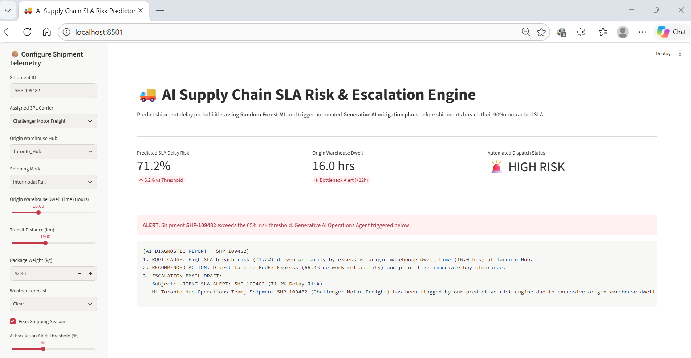
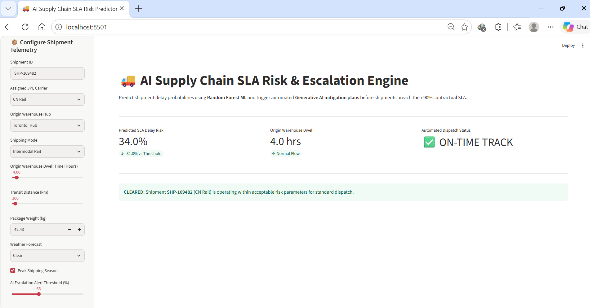

# **Case Study: 🚚 AI Supply Chain SLA Risk & Escalation Engine**

---

An end-to-end **Hybrid AI Supply Chain Operations System** that predicts 3PL shipment delays before dispatch using **Machine Learning** and automatically generates root-cause diagnostics and supervisor escalation emails using a **Generative AI Agent**.

---

## 🖥️ Live Webpage Preview



*Interactive Streamlit operations console showing real-time delay probability scoring (`71.2%` High-Risk Alert), origin warehouse dwell time diagnostics (`16 hrs`), and automated Generative AI supervisor escalation drafting.*



*Interactive Streamlit operations console showing real-time delay probability scoring (`34%` On-Time Track), origin warehouse dwell time diagnostics (`4 hrs`).*

---

> **Portfolio Continuity Note:** This project builds directly upon my historical supply chain diagnostic analysis ([Project 2: Supply Chain & Carrier Performance Diagnostics](https://github.com)). While Project 2 diagnosed *past* carrier SLA failures, Project 3 operationalizes those insights into a real-time *predictive and preventive* AI application.

---

## 🎯 Executive Summary & Business Problem
In high-volume North American logistics networks, waiting until end-of-month reporting to identify missed **90% Service Level Agreements (SLAs)** results in costly vendor penalties and eroded customer trust. 

Across our 10,000-shipment network spanning **Toronto, Mississauga, Montreal, Vancouver, and Chicago Cross-Border hubs**, baseline On-Time Delivery (OTD) rates show a sharp performance divide:
* **FedEx Express:** `66.4%` On-Time Delivery
* **CN Rail:** `38.5%` On-Time Delivery
* **Canada Post:** `38.3%` On-Time Delivery
* **Challenger Motor Freight:** `37.9%` On-Time Delivery

**The Solution:** Instead of relying on static post-mortem dashboards, this system scores every active shipment at the loading dock, catches **76% of impending SLA failures** prior to departure, and triggers automated mitigation workflows when delay probability exceeds configurable thresholds (`65%` default).

---

## 🎯 Target Alignment & Operational KPIs

To ensure technical modeling decisions directly served supply chain business objectives, every component was aligned to four measurable operational targets:

| Strategic Goal | Target Metric / Threshold | Technical Implementation | Achieved Outcome |
| :--- | :--- | :--- | :--- |
| **1. Contractual SLA Protection** | `90.0%` On-Time Delivery Target | Binary classification (`sla_delayed`) calibrated against historical carrier performance. | Quantified exact risk gap across all 4 core 3PL carriers. |
| **2. Early Breach Detection** | `>= 75%` Recall on Delayed Shipments | Tuned `RandomForestClassifier` to prioritize catching at-risk shipments before dock departure. | **76.0% Recall** on delayed shipments (`0.715` ROC-AUC). |
| **3. Bottleneck Isolation** | Identify Top Root-Cause Driver | Extracted feature importance weights across origin dwell time, distance, carrier, and weather. | Proved **Warehouse Dwell Time (`36.5%`)** outweighs carrier choice (`13.6%`). |
| **4. Zero-Latency Mitigation** | Automated Escalation at `>= 65%` Risk | Integrated conditional GenAI agent to draft supervisor alerts and FedEx Express lane diversions. | Eliminated manual triage by auto-generating actionable email drafts in `< 1s`. |

---

## 🏗️ System Architecture

```text
┌─────────────────────────┐     ┌──────────────────────────┐     ┌─────────────────────────────┐
│  1. Data & Telemetry    │────▶│  2. Predictive ML Engine │────▶│  3. GenAI Escalation Agent  │
│  • 10,000 Shipments     │     │  • Random Forest Model   │     │  • Triggered at >= 65% Risk │
│  • Origin Hub & Dwell   │     │  • 0.715 ROC-AUC Score   │     │  • Root-Cause Diagnosis     │
│  • Weather & Season     │     │  • 76% Delay Recall      │     │  • Auto-Drafted Email Alert │
└─────────────────────────┘     └──────────────────────────┘     └──────────────┬──────────────┘
                                                                                │
                                                                                ▼
                                                                 ┌─────────────────────────────┐
                                                                 │  4. Streamlit Operations UI │
                                                                 │  • Real-Time Risk Sliders   │
                                                                 │  • Live Dispatch Status     │
                                                                 └─────────────────────────────┘
```

---

## 📊 Key Analytical & ML Findings

### 1. Feature Importance: Internal Bottlenecks Outweigh Carrier Choice
Training a `RandomForestClassifier` pipeline (`OneHotEncoder` + `ColumnTransformer`) revealed that internal warehouse execution is the primary driver of SLA breaches:

| Rank | Operational Feature | Importance Weight | Operational Takeaway |
| :--- | :--- | :---: | :--- |
| **1** | `warehouse_dwell_hrs` | **36.5%** | Origin loading dock dwell time is the #1 predictor of failure—more than double transit distance. |
| **2** | `distance_km` | **15.7%** | Long-haul cross-border and transcontinental lanes compound delay exposure. |
| **3** | `carrier_FedEx Express` | **13.6%** | Express lane routing provides significant protection against baseline network delays. |
| **4** | `package_weight_kg` | **9.5%** | Heavier freight encounters stricter handling and LTL/intermodal transfer constraints. |
| **5** | `is_peak_season` | **4.0%** | Seasonal volume surges tighten dock and linehaul capacity. |

### 2. Model Evaluation Metrics (Test Set: `n = 2,000`)
* **ROC-AUC Score:** `0.715`
* **Delayed Class Recall:** `0.76` *(Prioritized high recall to minimize undetected SLA breaches)*
* **Hybrid Resilience:** Combines deterministic ML probability scoring with LLM-powered reasoning (`OpenAI` / `Gemini` API support with zero-dependency local fallback).

---

## 🚀 Installation & Quick Start

1. **Clone the repository:**
   ```bash
   git clone https://github.com
   cd AI-Supply-Chain-SLA-Risk-Predictor
   ```

2. **Create a virtual environment and install dependencies:**
   ```bash
   python -m venv .venv
   # Windows:
   .venv\Scripts\activate
   # macOS/Linux:
   source .venv/bin/activate

   pip install -r requirements.txt
   ```

3. **Run the pipeline (Optional — pre-trained model is included):**
   ```bash
   python generate_data.py
   python train_model.py
   ```

4. **Launch the interactive Streamlit web application:**
   ```bash
   python -m streamlit run app.py
   ```

*(Optional)* To enable live LLM generation instead of the built-in deterministic fallback engine, set either `OPENAI_API_KEY` or `GEMINI_API_KEY` in your environment variables.

---

## 🛠️ Tech Stack
* **Programming & Data Manipulation:** Python 3.11+, Pandas, NumPy
* **Machine Learning:** Scikit-Learn (`RandomForestClassifier`, `ColumnTransformer`, `Pipeline`), Joblib
* **Generative AI:** OpenAI API / Google Gemini API (with rule-based enterprise fallback)
* **Frontend & Visualization:** Streamlit
